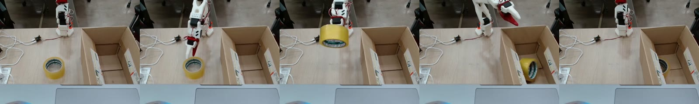

# SO-101 ACT — 노란 테이프를 집어 바구니에 넣기

SO-101 로봇 팔(리더·팔로워)로 시연을 녹화하고, [LeRobot](https://github.com/huggingface/lerobot) 0.6.1의 ACT 정책을 학습해 실제 로봇에서 실행하기까지의 전체 과정입니다.
녹화·실행용 Windows 스크립트, 학습 스크립트, 학습한 모델을 함께 공개합니다.

*An SO-101 arm picks up a roll of yellow tape and drops it into a box. ACT policy trained with LeRobot 0.6.1 on 15 teleoperated demonstrations from one fixed USB camera. The model in the release completed the task on the real robot. Docs are in Korean; scripts and comments are in English.*

[](media/example_episode.mp4)

> 위 이미지는 학습에 쓴 녹화 에피소드 중 하나입니다(클릭하면 20초 영상). 왼쪽부터 시작 → 잡기 → 들어 올리기 → 놓기 → 복귀.

**실험 보고서:** [docs/report.md](docs/report.md) — 1차 실험이 실패한 이유, 2차 실험이 성공한 이유, 실물 시연에서 확인한 한계 (옆자리 테이프, 세운 테이프, 시간 제한)

## 결과

| 모델 (Release 첨부 파일) | 학습 데이터 | chunk | 학습 step | 실물 로봇 |
|---|---|---|---|---|
| **`act_so101_tape_15ep_c100_050000`** | 15개 에피소드 | 100 (3.3초) | 50k | **성공** (`n_action_steps` 100) |
| `act_so101_tape_30ep_c100_100000` | 30개 에피소드 | 100 | 100k | 시험 안 함 |
| `act_so101_tape_30ep_c50_100000` | 30개 에피소드 | 50 | 100k | 시험 안 함 |
| `act_so101_tape_30ep_c30_100000` | 30개 에피소드 | 30 | 100k | 시험 안 함 |

- 작업 문장: `Grab the yellow tape and put in the basket`
- 카메라: 앞쪽 위에 고정한 USB 카메라 1대 (`front`, 640×480, 30fps). 손목 카메라 없음
- 학습: ACT 기본 설정(ResNet18, VAE), batch 8, A100 1장에서 50k step 약 35분 (GPU 메모리 약 2GB)
- 실행: Windows 노트북 CPU, 40초, 관절당 한 스텝 최대 10°
- 30개 모델은 녹화 도중 카메라가 한 번 움직여서(약 35px) 두 가지 화면이 섞여 있습니다. 성공한 15개 모델은 한 화면만 썼습니다.

> 📌 **데이터셋은 대표 에피소드 1개만 올렸습니다.** 학습에 쓴 녹화 데이터 전체(30개 에피소드)는 공개하지 않습니다. [`media/example_episode.mp4`](media/example_episode.mp4)는 그중 대표 1개를 일반 영상(H.264)으로 바꾼 것입니다. 재현하려면 직접 녹화해서 학습합니다 (15개 녹화 약 1시간, 학습 약 35분).

## 구성

| | 사용한 것 |
|---|---|
| 로봇 | SO-101 팔로워 + 리더 (Feetech STS3215), 팔마다 전원 어댑터 |
| 카메라 | USB 웹캠 1대, 640×480 @ 30fps, 앞쪽 위에서 약 45°로 내려다보게 고정 |
| 물체 | 노란 박스 테이프 1개, 종이 상자(바구니) |
| 녹화·실행 PC | Windows 노트북 (Miniforge, LeRobot 0.6.1, GPU 없음). USB 허브 |
| 학습 PC | Linux + NVIDIA GPU (A100 사용, 4GB 이상이면 충분) |

녹화·실행 PC와 학습 PC가 같아도 됩니다. Windows 스크립트(`scripts/win/*.bat`)는 LeRobot 명령을 감싼 것이라 Linux·macOS에서는 같은 명령을 직접 실행하면 됩니다 ([실행 문서](docs/4_rollout.md) 끝 참고).

## 빠른 실행: 공개한 모델 돌려 보기

> 이 모델은 **우리 책상·카메라 위치·테이프·바구니**에서 녹화한 15개로 학습했습니다. 환경이 다르면 그대로는 잘 안 될 가능성이 큽니다. 카메라 각도와 물체 배치를 [예시 영상](media/example_episode.mp4)과 최대한 비슷하게 맞추거나, 아래 "처음부터 재현"대로 직접 녹화해서 학습하세요.

로봇 PC(Windows)의 Miniforge Prompt에서:

```bat
conda activate lerobot
git clone https://github.com/SunAhKim0430/so101-act-tape-basket
cd so101-act-tape-basket\scripts\win

mkdir %USERPROFILE%\so101_models
curl -L -o %TEMP%\model.zip https://github.com/SunAhKim0430/so101-act-tape-basket/releases/download/v1.0/act_so101_tape_15ep_c100_050000.zip
tar -xf %TEMP%\model.zip -C %USERPROFILE%\so101_models
```

1. `config.bat`에 팔 COM 포트, 캘리브레이션 id, 카메라 번호를 적습니다 ([설치 문서](docs/1_setup.md)).
2. `1_check.bat`으로 팔과 카메라를 점검합니다.
3. 팔로워를 시작 자세(접어서 세운 자세)에 두고, 테이프를 영상과 같은 자리에 놓습니다.
4. 실행합니다.
   ```bat
   5_rollout.bat act_so101_tape_15ep_c100_050000 100
   ```
   모델 점검 → Enter → 40초 동안 실행 → 시작 자세로 돌아간 뒤 팔에 힘이 빠짐. 비상시에는 팔로워 전원 어댑터를 뽑습니다.

`git`이 없으면 이 페이지의 **Code → Download ZIP**으로 받아도 됩니다.

## 처음부터 재현

| 단계 | 어디서 | 문서 | 걸린 시간 (우리 기준) |
|---|---|---|---|
| 1. 설치 · 팔 점검 · 캘리브레이션 · 카메라 배치 | 로봇 PC | [docs/1_setup.md](docs/1_setup.md) | 반나절 |
| 2. 시연 녹화 (5개씩 × 3번 = 15개) | 로봇 PC | [docs/2_record.md](docs/2_record.md) | 세션 1번 약 8분, 쉬는 시간 포함 약 1시간 |
| 3. 학습 (chunk 30/50/100 동시) | 학습 PC | [docs/3_train.md](docs/3_train.md) | 50k step 약 35분 |
| 4. 실행 | 로봇 PC | [docs/4_rollout.md](docs/4_rollout.md) | 1회 40초 |

막혔을 때: [docs/troubleshooting.md](docs/troubleshooting.md) — 우리가 실제로 겪은 에러와 해결 방법

### 성공에 중요했던 것
- **고정 카메라 1대를 앞쪽 위에서.** 첫 시도(실패)는 손목 카메라만 써서 시작 자세에서 바구니가 보이지 않았습니다.
- **30fps, 작업이 끝나면 바로 `n`.** 첫 시도는 10fps에 60초를 꽉 채워 녹화해서 정지 프레임이 65%였습니다. 이번에는 22\~25%였습니다.
- **녹화부터 실행까지 카메라·바구니·조명을 그대로.** 카메라가 움직이면 그 전 녹화와 화면이 달라집니다.
- **시작 자세와 잡는 방식을 매번 같게.** 실패한 시연은 `r`로 버립니다.
- **실행할 때 `n_action_steps`를 chunk 크기만큼(100).** 노트북 CPU에서는 예측 한 번에 0.1\~0.25초가 걸리고 그동안 팔이 멈춥니다. 예측을 덜 하면 덜 멈칫거립니다.

## 저장소 구조

```text
scripts/
├── win/                    로봇 PC(Windows)용. config.bat 한 곳만 고치면 됨
│   ├── config.bat          COM 포트, 캘리브레이션 id, 카메라 번호, 녹화·실행 설정
│   ├── 1_check.bat         팔 / 카메라 / 관절 점검 (읽기 전용)
│   ├── 2_calibrate.bat     follower | leader 캘리브레이션
│   ├── 3_teleoperate.bat   리더로 팔로워 조종 (camera: 카메라 화면도)
│   ├── 4_record.bat        test (3개) | main pos1 [개수] (기본 5개)
│   ├── 5_rollout.bat       <모델 폴더 이름> [n_action_steps]
│   └── 6_view.bat          녹화한 에피소드를 영상 + 관절 그래프로 보기
├── record.py               lerobot-record + 저장 중에 눌린 키 무시 (4_record.bat이 사용)
├── check_robot.py          모터 응답·전압·캘리브레이션 확인 (1_check.bat)
├── check_motion.py         손으로 관절을 움직여 값이 따라오는지 (1_check.bat motion)
├── check_cameras.py        카메라 실제 fps + 스냅샷 (1_check.bat camera)
├── ep_stats.py             에피소드 길이, 정지 프레임 비율, 시작 자세 편차
├── check_model.py          실행 전 모델 폴더 점검 (5_rollout.bat이 사용)
├── train.sh                학습 PC: 녹화 점검 → 세션 합치기 → 통계 → ACT 학습 (Linux)
├── check_dataset.py        녹화 폴더 점검: 파일 누락, fps, 카메라, 영상 디코딩 (train.sh가 사용)
├── ep_frames.py            에피소드별 시작/잡기/끝 장면 모음 + 테이프 위치
└── cam_shift.py            녹화 세션끼리 카메라 화면이 움직였는지
docs/                       단계별 문서 (한국어), report.md = 실험 보고서
media/                      대표 에피소드 영상 1개 + 미리보기 이미지
```

## 참고
- LeRobot: https://github.com/huggingface/lerobot (0.6.1 사용. 0.7 이후는 명령이나 내부 코드가 달라 `record.py` 등이 동작하지 않을 수 있음)
- SO-101: https://github.com/TheRobotStudio/SO-ARM100
- ACT: Zhao et al., *Learning Fine-Grained Bimanual Manipulation with Low-Cost Hardware*, RSS 2023 — https://arxiv.org/abs/2304.13705
